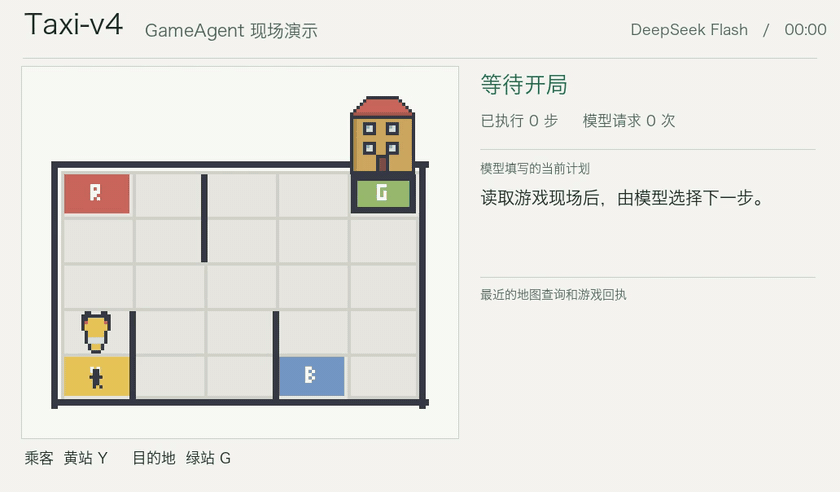

# GameAgent

GameAgent 是一个可接入不同游戏的本地 LLM 运行时。游戏适配器提供玩家能获得的现场信息、目标与可选动作；模型决定下一步；游戏回执告诉它这一步实际发生了什么。仓库内可以启动一个最小沙盒，也可以让模型玩 MiniGrid 的 DoorKey 和 LavaGap。



*早期 Taxi-v4 现场演示。DeepSeek 在第 2 步接到乘客，第 11 步送达，全程 13 次模型请求。录像对应的原生轨迹为 `demo/live`。画面由 Gymnasium 渲染。* [实测记录](docs/experiments.md) · [Gymnasium 许可](docs/licenses/gymnasium.txt)

## 快速开始

支持 macOS 和 Linux。准备 Python 3.9+、Node.js 24+ 和 npm。MiniGrid 示例与历史回放使用 Python 3.12。

```sh
git clone https://github.com/JunyeZzzz/gameagent.git
cd gameagent
(cd runtime && npm ci --ignore-scripts --no-audit --no-fund)
python3 -m unittest discover -s tests -v
node --test tests/test_*.mjs
```

以上测试使用本地模拟模型，覆盖真实的模型客户端、工具调用、执行回执、跨轮状态和监控查询。连接实际模型时，先在当前终端设置 `GAMEAGENT_API_KEY` 或 `DEEPSEEK_API_KEY`。默认模型 ID 为 `deepseek-flash`，默认服务为 `https://api.deepseek.com`。兼容流式 Chat Completions 和工具调用的服务可通过 `GAMEAGENT_MODEL_URL` 与 `GAMEAGENT_MODEL` 配置。

实时决策在 DeepSeek 官方端点显式使用快速回复模式。请求达到输出上限却没有给出动作时，运行时保留会话，读取新现场后继续判断。运行记录中的 `output_limit` 表示本轮输出不完整。[DeepSeek 模式说明](https://api-docs.deepseek.com/guides/thinking_mode/)

模型可以在观察时给出本轮公开判断并保持当前状态。一次性目标完成后，模型可引用本局最后一步的成功回执，进入持续观察。观察器仍采样，当前运行在目标或游戏会话变化后恢复决策。换目标时，上一目标已有的回执会标为历史信息，新要求的动作须取得新的证据。对于“保持跟随”等持续性目标，模型在动作执行过程中继续复核。

```sh
mkdir -p local
world=$(mktemp -d "$PWD/local/sandbox.XXXXXX")
cp state/fixture.json "$world/fixture.json"
GAMEAGENT_ROOT="$world" python3 run.py
```

沙盒从位置 0 出发，目标是位置 3。到达目标后进程会等待；按 Ctrl+C 停止。运行 `python3 run.py --once` 可在默认环境执行一个观察与决策周期。另开终端，在同一项目根目录运行 `python3 monitor.py` 并访问它打印的本机地址，可查看每轮观察、模型公开输出、工具调用和游戏回执。单轮可能包含多个模型请求。

## 让模型玩 MiniGrid

在项目根目录用 Python 3.12 安装示例依赖，使用上面设置的模型密钥启动。

```sh
python3.12 -m venv .venv
.venv/bin/python -m pip install -r examples/minigrid/requirements.txt
mkdir -p local
world=$(mktemp -d "$PWD/local/minigrid.XXXXXX")
cp examples/minigrid/worlds/door-key-b.json "$world/episode.json"
GAMEAGENT_ROOT="$world" .venv/bin/python run.py --adapter doorworld
```

模型需要转身、拾取钥匙、开门并走到目标。换用 `door-key-8x8.json` 或 `lava-gap-24.json`，可以在新局里观察大地图和熔岩岔路上的选择。该示例使用 MiniGrid 的全图观察，提供朝向、面前地块、背包、原生动作和到已知地标的路线首步。

已安装示例依赖后，可在本机逐步核对归档中的 53 局、881 个游戏动作。两条命令都可以离线运行，无需模型密钥。

```sh
.venv/bin/python benchmarks/replay.py
.venv/bin/python benchmarks/replay.py --episode effects/lava24
```

## 一次行动如何发生

1. Python 从适配器读取带会话、版本和有效期的快照，附上最近已确认的动作。
2. 持久运行的 Pi 客户端把目标、事实、候选动作发给模型。模型可刷新观察、等待，或提交一个动作。地图导航提供到地标的下一步，模型仍可选择任一原生动作。
3. 运行时校验当前快照并持久化意图。适配器调用游戏，回传完成、失败或仍待确认的证据。待确认期间保留意图，防止重复执行。
4. 独立观察进程在模型推理和游戏执行期间持续采样。重要变化会唤起新决策，动作完成会打断过时的模型请求。当前采样写入 `perception.json`，逐轮事件写入 SQLite。

| 想做的事 | 入口 |
| --- | --- |
| 接一个新游戏，定义地图和动作 | [适配器接口与示例](docs/adapters.md) |
| 理解调度、动作恢复和会话取舍 | [架构设计](DESIGN.md) |
| 看真实模型在哪些地图通过、失败，以及每步耗时 | [实验方法与结果](docs/experiments.md) |
| 检查某一局的模型请求数、每一步的游戏结果 | [逐局索引](benchmarks/data/episodes.json) · [逐步原始状态摘录](benchmarks/data/native-steps.jsonl) |

默认游戏状态保存在 `state/`，运行状态、会话和轨迹保存在 `data/`。可用 `GAMEAGENT_ROOT` 和 `GAMEAGENT_HOME` 指定项目内两个不同且互不包含的目录。监控读取相同的 `GAMEAGENT_HOME`。行动期间每轮模型判断结束后，以新采样开始下一轮，游戏持续执行已接单的动作。现场关键变化可以中止过期判断。需要定期复核相同空闲现场时，可将 `GAMEAGENT_INTERVAL` 设为正秒数。

当前实测覆盖有结构化观察和离散动作的短局游戏。开放世界中的自主选目标、持续操控载具和高频实时响应仍待验证。
